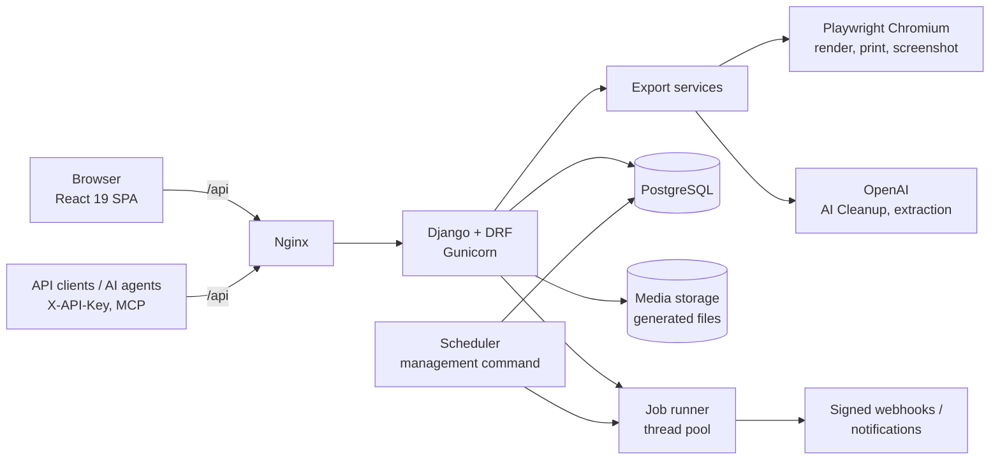

# ExtractKit

**Turn any webpage, or a whole site, into clean PDF, Markdown, JSON, CSV/Excel or screenshots, through a web app, a REST API, or MCP tools for AI agents.**

ExtractKit is a full-stack SaaS I designed and built solo: a React 19 + TypeScript single-page app on top of a Django 5 / Django REST Framework API that renders pages with headless Chromium (Playwright), strips clutter with an LLM, extracts schema-validated data, and runs exports as async, idempotent jobs with signed webhooks, recurring schedules and page-change monitoring.

> **Status:** The hosted instance (extractkit.io) is currently offline. The source is published as a portfolio piece; everything below runs locally.

---

## Features

**Export tools**

| Tool | Output | Notes |
|------|--------|-------|
| Web → PDF | `.pdf` | Chromium print rendering; combined bulk PDFs get a cover page and table of contents (merged with PyMuPDF) |
| Web → Markdown | `.md` | Page content converted with `markdownify` |
| Web → JSON | `.json` | Standard fields (metadata, JSON-LD, headings, paragraphs, tables, images, links) **or** custom extraction |
| Web → CSV / Excel | `.csv` / `.xlsx` | Records, tables and metadata; XLSX written directly as OOXML, cells guarded against formula injection |
| Web → Screenshot | `.png` | Full-page, high-resolution captures |

PDF and screenshot exports render in headless Chromium; Markdown and JSON exports fetch over HTTP and fall back to Chromium when the response is an empty client-side app shell. PDF, Markdown, JSON and screenshot exports also run in bulk, over a list of URLs or a **whole website** discovered from its sitemap or a bounded same-domain crawl (max pages/depth, include/exclude glob patterns), returning a ZIP or a single combined file.

**Three cleanup modes**

- **Full page:** export as rendered.
- **AI Cleanup:** an OpenAI model receives a compact, bounded DOM outline (not the raw HTML) and returns candidate elements to drop: nav bars, ads, cookie banners, popups, unrelated sidebars. Each removal is accepted only if the page still keeps at least 65% of its text, 70% of its paragraph text and its `<h1>`, so a bad model answer cannot gut the article. Missing keys or API failures surface as explicit errors instead of silent heuristics.
- **Manual:** a sandboxed preview where you click elements to remove; the chosen CSS selectors are applied server-side.

**Custom structured extraction.** Describe the records you want in plain language ("every product's name, price and availability"), optionally supply a JSON Schema, and the result is validated with `jsonschema` before it is returned or exported to CSV/Excel.

**Developer platform**

- **Async jobs** (`POST /api/jobs/`) with `Idempotency-Key` support (safe retries return the original job) and rerun/download endpoints.
- **API keys** sent as `X-API-Key`; only a SHA-256 hash and a display prefix are stored.
- **Webhooks** signed with HMAC-SHA256 (`X-ExtractKit-Signature: sha256=…`) for `export.completed` / `export.failed`.
- **OpenAPI 3** via drf-spectacular: a filtered public schema with Swagger UI at `/api/developer/docs/` (internal/dashboard endpoints excluded; a full schema is exposed only when `DEBUG` is on).
- **MCP endpoint** (`POST /api/mcp/`): authenticated JSON-RPC implementing `initialize`, `tools/list` and `tools/call` with `create_export_job`, `get_export_job` and `list_export_jobs`, so AI agents can drive exports.
- **Recurring schedules** (hourly/daily/weekly/monthly) with per-schedule webhooks.

**Webpage change monitoring** (behind a feature flag)

- Watch cleaned text, specific CSS selectors, structured JSON fields, or visual screenshots.
- Noise controls: minimum change threshold, ignored selectors/regexes, whitespace/case/number normalization.
- Snapshot timeline, baseline reset/restore, side-by-side and inline text diffs, before/after image slider with pixel-diff images.
- Notifications by email (HTML diffs), webhook, Slack, Discord, Microsoft Teams and Telegram; immediate or daily/weekly digests; delivery history with retry.
- "Change intelligence": classifies changes (price, availability, CTA, policy, SEO) and explains why they matter, using a deterministic local analyzer or, optionally, OpenAI.

**Accounts and billing:** email/password and Google sign-in issuing JWTs; a USD-cent wallet with per-export metered pricing (configurable in settings) topped up through NOWPayments, with HMAC-SHA512-verified IPN callbacks.

The design notes for the monitoring feature are in [docs/change-monitoring.md](docs/change-monitoring.md).

---

## Architecture



A few design decisions worth calling out:

- **One code path for sync and async exports.** The job runner replays a stored request through the same DRF view used by the interactive tools (`backend/app/jobs.py`), so validation, billing and output generation are identical whether a page is exported from the UI, the REST API, a schedule or MCP.
- **Safe job claiming.** A job moves from `pending` to `running` with a single conditional `UPDATE`, so a job is never executed twice even if it is enqueued twice.
- **No broker required.** Jobs live in PostgreSQL and run on an in-process thread pool; a separate `scheduler` process (`manage.py run_scheduled_exports --loop`) polls for due schedules, monitors and digests. That keeps the deployment to Postgres + two Django processes + Nginx, at the cost of horizontal job scaling, which a Celery/RQ worker could add later.
- **Public vs. internal API surface.** The public OpenAPI schema is generated from a dedicated URLconf plus a post-processing hook, so dashboard and payment endpoints never leak into the developer docs.

---

## Tech stack

| Layer | Technologies |
|-------|--------------|
| Frontend | React 19, TypeScript, Vite 8, React Router 7, Tailwind CSS 4, lucide-react, Google OAuth |
| Backend | Python 3.11, Django 5.2, Django REST Framework, SimpleJWT, drf-spectacular |
| Rendering and extraction | Playwright (Chromium), PyMuPDF, Beautiful Soup, markdownify, Pillow (visual diffs) |
| AI | OpenAI API (any OpenAI-compatible base URL), JSON Schema validation with `jsonschema` |
| Data | PostgreSQL 16 (psycopg 3) |
| Infrastructure | Docker Compose, Gunicorn, Nginx; or systemd + Nginx + Let's Encrypt (see [DEPLOY.md](DEPLOY.md)) |
| Payments | NOWPayments (crypto) |

---

## Repository layout

```
.
├── backend/
│   ├── app/
│   │   ├── services/          # pdf/markdown/json/tabular/screenshot generators,
│   │   │                      # AI cleaner, custom extractor, crawler, credits,
│   │   │                      # change intelligence
│   │   ├── views.py           # export tools, preview, crawl, auth, payments
│   │   ├── views_jobs.py      # async jobs and schedules
│   │   ├── views_developer.py # API keys, usage, integrations
│   │   ├── views_mcp.py       # MCP JSON-RPC endpoint
│   │   ├── views_monitoring.py
│   │   ├── jobs.py            # job runner and webhook delivery
│   │   ├── schedules.py       # recurring export scheduling
│   │   ├── monitoring.py      # snapshots, diffs, notifications
│   │   ├── management/commands/run_scheduled_exports.py
│   │   ├── migrations/
│   │   └── tests.py
│   ├── backend/settings.py    # single settings module, reads ../.env
│   ├── Dockerfile
│   └── requirements.txt
├── frontend/
│   ├── src/
│   │   ├── pages/             # one page per tool, monitoring, developer API/docs, blog
│   │   ├── components/        # navigation, auth, billing, monitor dialogs, Markdown renderer
│   │   ├── context/           # auth context (JWT + refresh)
│   │   └── lib/               # API clients, feature flags, utilities
│   ├── nginx.conf             # SPA + /api reverse proxy for the Docker image
│   └── Dockerfile
├── docs/change-monitoring.md  # design notes for the monitoring feature
├── docker-compose.yml         # db, backend, scheduler, frontend
├── DEPLOY.md                  # Ubuntu + Nginx + HTTPS and Docker deployment guide
└── .env.example
```

---

## Running locally

All configuration lives in a single `.env` file at the repository root (Django loads it from `backend/backend/settings.py`; Docker Compose passes it to every service).

```bash
cp .env.example .env
```

Then edit `.env`:

- set `SECRET_KEY` and `POSTGRES_PASSWORD`;
- set `DEBUG=True` for local HTTP use (with `DEBUG=False`, Django enforces HTTPS redirects and secure cookies, which is what production behind TLS expects);
- optionally set `CHANGE_MONITORING_ENABLED=true` (and `VITE_ENABLE_CHANGE_MONITORING=true` for Docker builds) to turn on monitoring;
- optionally add `OPENAI_API_KEY` for AI Cleanup and custom extraction.

### Option A: Docker Compose

```bash
docker compose --env-file .env up -d --build
```

This starts PostgreSQL, Django/Gunicorn (runs migrations and `collectstatic` on start), the scheduler, and an Nginx container serving the built SPA and proxying `/api`. Open <http://localhost:8080>.

```bash
docker compose --env-file .env exec backend python manage.py createsuperuser   # optional
docker compose --env-file .env logs -f backend scheduler
```

### Option B: Run the services directly

Prerequisites: Python 3.11+, Node.js 20.19+ or 22.12+, and PostgreSQL. On a fresh Linux box, `playwright install --with-deps chromium` also installs Chromium's system libraries.

**Backend** (API on <http://127.0.0.1:8000>):

```bash
python3 -m venv .venv && source .venv/bin/activate
pip install -r backend/requirements.txt
playwright install chromium

# role and database matching POSTGRES_USER / POSTGRES_PASSWORD / POSTGRES_DB in .env
# (CREATEDB lets the same role run the test suite)
psql -d postgres -c "CREATE ROLE extractkit LOGIN CREATEDB PASSWORD 'change-me';"
psql -d postgres -c "CREATE DATABASE extractkit OWNER extractkit;"

cd backend
python manage.py migrate
python manage.py runserver
```

**Scheduler** (only needed for schedules and monitors; second terminal, same venv):

```bash
cd backend
python manage.py run_scheduled_exports --loop --interval 60
```

**Frontend** (on <http://localhost:5173>):

```bash
cd frontend
npm ci
VITE_API_BASE_URL=http://127.0.0.1:8000 npm run dev
```

For local Vite runs, `VITE_*` variables can also go in `frontend/.env`.

API docs are served at <http://127.0.0.1:8000/api/developer/docs/> (public schema) and, with `DEBUG=True`, <http://127.0.0.1:8000/api/internal/docs/> (everything).

### Configuration

Every variable the code reads is listed, with placeholder values and comments, in [`.env.example`](.env.example). Grouped by what they unlock:

| Group | Variables | Needed for |
|-------|-----------|------------|
| Django | `SECRET_KEY`, `DEBUG`, `ALLOWED_HOSTS`, `CHANGE_MONITORING_ENABLED` | Always |
| Database | `POSTGRES_DB`, `POSTGRES_USER`, `POSTGRES_PASSWORD`, `POSTGRES_HOST`, `POSTGRES_PORT` | Always |
| Frontend build | `VITE_API_BASE_URL`, `VITE_ENABLE_CHANGE_MONITORING`, `VITE_GOOGLE_CLIENT_ID`, `VITE_API_URL` | SPA build |
| AI | `OPENAI_API_KEY`, `OPENAI_BASE_URL`, `AI_CLEANUP_MODEL`, `AI_CLEANUP_RENDER_WAIT_MS`, `CUSTOM_EXTRACTION_MODEL`, `AI_CHANGE_USE_OPENAI`, `AI_CHANGE_MODEL` | AI Cleanup, custom extraction, change summaries |
| Google sign-in | `GOOGLE_CLIENT_ID` | "Sign in with Google" |
| Email | `EMAIL_BACKEND`, `EMAIL_HOST`, `EMAIL_PORT`, `EMAIL_HOST_USER`, `EMAIL_HOST_PASSWORD`, `EMAIL_USE_TLS`, `EMAIL_USE_SSL`, `DEFAULT_FROM_EMAIL` | Password reset, monitor emails (console backend by default) |
| Payments | `NOWPAYMENTS_API_KEY`, `NOWPAYMENTS_IPN_SECRET`, `NOWPAYMENTS_SANDBOX`, `NOWPAYMENTS_IPN_CALLBACK_URL`, `NOWPAYMENTS_SUCCESS_URL`, `NOWPAYMENTS_CANCEL_URL` | Wallet top-ups |

Per-export prices (`USAGE_PRICES_CENTS`) and wallet packages are plain settings in `backend/backend/settings.py`, so they can change without migrations.

---

## Using the API

Create an API key on the **Developer API** page, then queue an export:

```bash
curl -X POST http://127.0.0.1:8000/api/jobs/ \
  -H "X-API-Key: $EXTRACTKIT_API_KEY" \
  -H "Idempotency-Key: example-export-001" \
  -H "Content-Type: application/json" \
  -d '{
        "endpoint": "markdown",
        "payload": {"url": "https://example.com", "ai_cleanup": true},
        "webhook_url": "https://your-app.example/hooks/extractkit"
      }'
```

The response (`202 Accepted`) contains the job `id` and status and, when a webhook is configured, its `webhook_secret` (generated if you don't supply one). Poll `GET /api/jobs/{id}/` or wait for the webhook, then fetch `GET /api/jobs/{id}/download/`. `endpoint` can be `pdf`, `markdown`, `json`, `tabular`, `screenshot`, `crawl`, or a `bulk-*` variant.

Verify a webhook by recomputing the signature over the raw body:

```python
import hashlib, hmac

def is_valid(raw_body: bytes, header: str, secret: str) -> bool:
    expected = "sha256=" + hmac.new(secret.encode(), raw_body, hashlib.sha256).hexdigest()
    return hmac.compare_digest(expected, header)
```

---

## Testing

**Backend:** 90 Django tests covering content extraction, crawling, AI Cleanup guardrails, custom extraction, CSV/XLSX export, auth (including Google sign-in), wallet billing, async jobs and idempotency, API keys, MCP, schedules and webpage monitoring. External calls (OpenAI, HTTP fetches, the browser, email) are mocked, so no API keys or Chromium download are needed; the tests only need a reachable PostgreSQL whose user may create a test database.

```bash
cd backend
DEBUG=True CHANGE_MONITORING_ENABLED=true python manage.py test app
```

The two variables override `.env`: the monitoring routes are only registered when the flag is on, and `DEBUG=False` would turn on HTTPS redirects.

**Frontend:** there are no frontend unit tests yet; the production build is the check.

```bash
cd frontend
npm run build      # outputs to frontend/dist/
```

---

## Deployment

[DEPLOY.md](DEPLOY.md) covers two production paths: a classic Ubuntu setup (Gunicorn and scheduler as systemd services, Nginx, Let's Encrypt, `update.sh` for redeploys) and the Docker Compose stack behind a TLS-terminating reverse proxy, plus backup notes.

## Project status

ExtractKit was built and operated as a solo side project. The public deployment is currently offline; the code is kept here as a reference implementation. Webpage change monitoring is implemented but was switched off for the public deployment (`CHANGE_MONITORING_ENABLED=false` in `.env.example`).

Built by [Mohammad Hossein Karimi](https://github.com/karimimh).

## License

Released under the [GNU Affero General Public License v3.0](LICENSE). If you run a modified version as a network service, you must make its source code available to its users.
